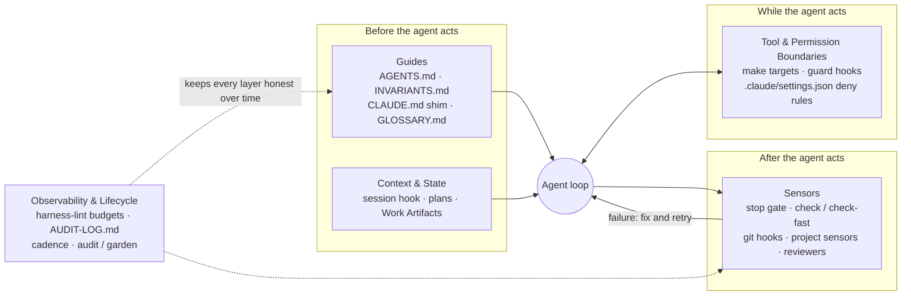

# 1. Concepts

## What a repository harness is

An AI coding agent is a model plus everything around it: the instructions it loads, the commands it can run, the checks that catch its mistakes, and the limits on what it may touch. The design follows the common industry harness model:

> **Agent = Model + Harness**

You don't control the model. You control the harness. So when an agent gets something wrong, the fix goes into the harness: a rule, a check, a better pointer. It does not go into a cleverer prompt you have to remember to paste next time. The `harness-learn` skill turns this into a habit. A repeated mistake becomes a sensor, a hook, an invariant or a footgun, preferring the strongest one that fits.

This plugin builds an **engineering-time** harness. That means files and checks in your repo that shape how agents write code. It does **not** cover runtime concerns such as tool dispatch, retries, cost ceilings or runtime metrics.

Principles the plugin follows everywhere:

- **Evidence or a marker.** Every path, command or env var the plugin writes comes from a `file:line` it saw. If it has no evidence, it writes `[verify]` or `TODO` and never invents one.
- **Ask only what code can't answer.** Anything the scan proves is applied automatically. Judgement calls are asked, and each one comes with a default.
- **Ratchet.** A rule earns its place by tracing to a real failure, incident or hard constraint. Generic advice doesn't count.
- **A model grading itself is not a measurement.** Levels and scores come from a script (`level.py`), not from the agent's opinion.
- **No named packs.** The harness works alongside any skill pack and never names one. The harness holds the facts; packs bring process.

## The five control layers

Every scan finding, generated file, audit item and interview question is tagged with one of these layers. In files and scripts the layer keys are `guides`, `sensors`, `context`, `tools`, `observability`.

### Guides (`guides`)

| | |
|---|---|
| **Controls** | What the agent reads before acting: the map of the repo, the hard rules, vocabulary, decisions, and who may do what. |
| **Acts** | Before. Loaded at session start through the `CLAUDE.md` shim (`@AGENTS.md`, `@INVARIANTS.md`). |
| **Prevents** | The agent guessing: reading random files first, inventing commands, ignoring constraints nobody wrote down, renaming domain concepts, pushing to main because no one said not to. |
| **Implemented by** | `AGENTS.md` (Verification, Working Principles, Agent skills, Work Artifacts, Context loading, Agent Authorization, Modules, Footguns), `INVARIANTS.md`, `CLAUDE.md`, module `AGENTS.md`, `GLOSSARY.md`, `docs/ARCHITECTURE.md`, `docs/DECISIONS.md` + `docs/adr/`, `docs/agents/*.md`. Guarded by `guard-files.sh`, which keeps `CLAUDE.md` a shim and asks before `INVARIANTS.md` edits. |
| **Example** | `INVARIANTS.md` says `- No real customer or production data in seeds or fixtures — Severity: Critical — Enforced by: sensor no-prod-data`. An agent asked to "add realistic seed data" reads this first and uses synthetic data. |

### Sensors (`sensors`)

| | |
|---|---|
| **Controls** | Checks that observe the work and fail loudly: the `check` / `check-fast` gate, project sensors for specific invariants, and the reviewer agents. |
| **Acts** | After, and during the loop: the stop gate runs when the agent tries to finish; git hooks run on commit and push; `harness-verify` runs before "done". |
| **Prevents** | "Done" claims with no evidence, broken builds handed to humans, rules that exist only on paper, and verification theatre (tests skipped or weakened to pass). |
| **Implemented by** | `harness.mk` targets `check`, `check-fast`, `lint`, `typecheck`, `test`; `stop-gate.sh` (Stop hook; SubagentStop marks a red implementer branch in its own worktree, which the Bash guard then refuses to merge); `.githooks/pre-commit` (check-fast) and `.githooks/pre-push` (check); `scripts/harness/sensors/` + `registry.json` + `fixtures/`; `sensor-proof.sh`; `red-proof.sh` (the change's tests fail without it, run by the verifier; a plan closes only with its `Red:` line); agents `verifier`, `invariants-reviewer`, `scope-guard`, `cross-repo-reviewer`, `sensor-smith`; optional CI workflow `harness.yml`. |
| **Example** | The agent edits a file and tries to stop. `stop-gate.sh` sees uncommitted source changes, runs `check-fast`, it fails, and the stop is blocked with `Stop blocked by agent-harness: a repo's check-fast failed on your changes.` and a summary of the output: lines with failure markers (`FAIL`, `ERROR`, `expected`, `Tests run:…Failures`…), then the last 10 lines. |

Invariants carry a severity:

| Severity | Effect |
|---|---|
| **Critical** | Fails `check` and blocks the stop gate (once a machine enforces it). |
| **Important** | A warning; `harness-verify` stops and hands it to a human (`NEEDS-HUMAN`). |
| **Nice-to-have** | Appears in the audit only. |

A sensor is wired in only after `sensor-smith` proves it. The proof checks that clean code passes, that a planted violation in a fixture fails with a message, and that clean code passes again. `harness-lint` re-runs every fixture (`sensor-proof.sh --recheck`), so a sensor that silently stops firing is caught.

### Context & State (`context`)

| | |
|---|---|
| **Controls** | What the agent loads for a given task, and where work in progress lives so it survives `/clear`, compaction or a new session. |
| **Acts** | Before (session orientation, Context loading table) and during (the plan is updated as steps finish). |
| **Prevents** | Lost work after a context reset, re-doing finished steps, carrying invented facts forward, plans and specs scattered across pack-specific folders, and an auto-loaded set so big it crowds out the task. |
| **Implemented by** | `session-context.sh` (SessionStart hook: branch, uncommitted count, active plan, next unchecked step, last progress line); `AGENTS.md` Context loading and Work Artifacts; `docs/plans/` (`active/`, `done/`, `TEMPLATE.md`); `docs/specs/`; `harness-session` skill; `.gitignore` entries for `.harness/`, `.worktrees/` and pack scratch folders; `lint.sh` size budgets. |
| **Example** | After `/clear`, the session starts with `[agent-harness] active plan: docs/plans/active/2026-10-20-export.md` and `[agent-harness] next unchecked: 3. Add CSV writer → verify: make test T=…`. The agent picks up at step 3. |

### Tool & Permission Boundaries (`tools`)

| | |
|---|---|
| **Controls** | Which commands the agent runs (one command surface), how a fresh machine or worktree gets a working dev setup, and what the agent may never do. |
| **Acts** | During: every Bash command and every file write passes a guard hook. |
| **Prevents** | Raw tool commands that differ per developer, destructive git operations, bypassing hooks, writing secrets, overwriting `CLAUDE.md` from the shell, seeding a non-local database, and "works on my machine" setups. |
| **Implemented by** | `Makefile` + `harness.mk` (or `.agents/harness.json` for another runner); `scripts/harness/cmd.sh` (command resolver); `guard-bash.sh`/`guard_bash.py` and `guard-files.sh` (PreToolUse hooks); `.claude/settings.json` deny rules; `scripts/harness/setup.sh`, `setup-proof.sh`, `local-guard.sh`; `docs/SETUP.md`; agent `setup-smith`. |
| **Example** | The agent runs `git commit --no-verify -m "wip"`. The guard denies it: `Bypassing git hooks (--no-verify / -n) is blocked by INVARIANTS.md. Fix the failing check instead.` |

### Observability & Lifecycle (`observability`)

| | |
|---|---|
| **Controls** | The health of the harness itself over time: size budgets, audit cadence, and the measured history. |
| **Acts** | After, and on a schedule: `harness-lint` in every `check`, the session hook's staleness warning, monthly/quarterly audits, weekly gardening. |
| **Prevents** | Harness rot: dead links, stale commands, an `AGENTS.md` that grew into a manual, rules duplicated in three places, sensors that no longer fire, and levels that are claimed but not real. |
| **Implemented by** | `lint.sh` (budgets, links, ADR index, command names, invariant format, sensor recheck); `AGENTS.md` `## Cadence`; `docs/harness/AUDIT-LOG.md` (one script-measured line per audit); `level.py`; skills `harness-audit` and `harness-garden`; agent `harness-auditor`. |
| **Example** | The last `AUDIT-LOG.md` row is 45 days old and Cadence says `quick audit: every 30 days`. The next session shows `[agent-harness] harness audit is 45 days old — run /harness-audit`. |

## Maturity levels

The level is **measured, never declared**. `level.py` evaluates fixed criteria against the repo and reports the highest level whose criteria all pass, plus its own criteria. Each level includes the criteria of the levels below it. If nothing passes, the level is `none`.

| Level | Criteria checked by `level.py` (layer) |
|---|---|
| **Experimental** | `AGENTS.md` and `INVARIANTS.md` both exist (guides) · `CLAUDE.md` is absent or contains `@AGENTS.md` (guides) · `scripts/harness/lint.sh` passes (context) |
| **Functional** | `check` passes: with `--run-checks` it is resolved and run; without it, `.harness/last-check` must record a pass (sensors) · automatic enforcement: `.githooks/pre-commit` with `core.hooksPath=.githooks`, or a hook manager config (`lefthook.yml`, `.pre-commit-config.yaml`, `.husky/*`) that runs `check-fast`, or a CI file that runs `check` (sensors) · at least one invariant is machine-enforced: its `Enforced by:` names a make target, sensor, hook, guard, CI job, lint, test or a script path. Human review, an agent, `none` or `not yet enforced` does not count (guides) |
| **Robust** | `docs/plans/` exists (context) · `.claude/settings.json` has `permissions.deny` rules (tools) · at least one sensor in `scripts/harness/sensors/registry.json` and `sensor-proof.sh --recheck` passes (sensors) · no lint budget failure (context) · `AGENTS.md` has a Cadence section (observability) · no invariant under `## Security` or `## Data Integrity` is `not yet enforced` (guides) |
| **Enterprise** | a CI file (`.github/workflows/*.yml`, `.gitlab-ci.yml`, `.circleci/config.yml`, `Jenkinsfile`) runs `check` (sensors) · `.claude/settings.json` `enabledPlugins` pins `agent-harness` (tools) · `CODEOWNERS` (root, `.github/` or `docs/`) covers `AGENTS.md` and `INVARIANTS.md` (guides) · `AUDIT-LOG.md` has 2+ rows and the last level is not lower than the previous one (observability) · in a workspace, every member is at Functional or higher (observability) |

Each layer gets a score: the share of its criteria that pass, across all four tiers. The audit shows these as `guides 0.80`, `tools 0.50` and so on.

### Target vs current level

- **Current level:** what `level.py` measures now.
- **Target level:** what the team wants. It is chosen in the Guides section of `harness-init` and recorded in `INVARIANTS.md` as `- Harness target: <level>` (the template default is `Robust`).

The target decides the scope of setup and audit:

| Target | Layers set up by `harness-init` |
|---|---|
| Functional | Guides and Sensors |
| Robust | All five |
| Enterprise | All five, plus CI, CODEOWNERS and audit history |

`harness-audit` never recommends work beyond the target. It says in one line what the next level would need.

### Why measured, not declared

A level the agent assigns itself is a self-grade. It drifts toward "looks good" and can't be compared over time. `level.py` reads files, runs lint, and (with `--run-checks`) runs the real `check`. The audit appends only these numbers to `docs/harness/AUDIT-LOG.md` (date, level, layer scores, health score, auto-loaded tokens). Judgements stay in the conversation. That gives the Enterprise "scores holding or improving" criterion something real to compare against.

Note: the level criteria are this plugin's own definitions.
