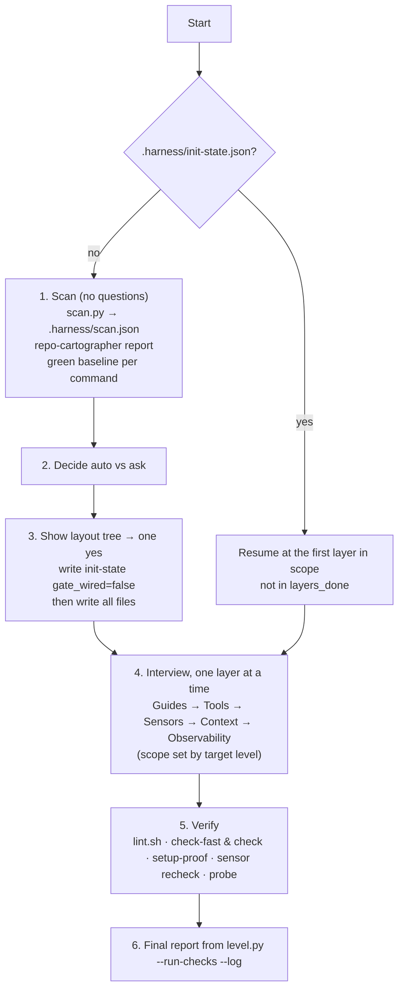

# 3. User guide

## 3.1 Install

### Claude Code (recommended)

Push the `agent-harness` repository somewhere your team can read it, then in each repo:

```bash
claude plugin marketplace add salescode-ai/agent-harness
claude plugin install agent-harness@agent-harness --scope project
```

Project scope writes to the committed `.claude/settings.json`, so everyone on the repo gets the same hooks and guards. `harness-init` also writes this pin (`enabledPlugins: {"agent-harness@agent-harness": true}`) when you approve the settings.

The plugin brings:

- **Skills:** `harness-init`, `harness-audit`, `harness-upgrade` and `harness-workspace` (you invoke these); `harness-improve` (offered at the end of init and audit; you or the agent start it), `harness-verify`, `harness-session`, `harness-learn`, `harness-garden` and `harness-glossary` (the agent uses these when they fit, or you ask for them).
- **Agents:** `repo-cartographer`, `verifier`, `invariants-reviewer`, `scope-guard`, `cross-repo-reviewer`, `harness-auditor`, `sensor-smith`, `setup-smith`.
- **Hooks:** SessionStart (`session-context.sh`), PreToolUse on Bash (`guard-bash.sh`), PreToolUse on Edit/Write/MultiEdit (`guard-files.sh`), Stop (`stop-gate.sh`), SubagentStop (`stop-gate.sh --subagent`).

Requirements: `git`, `bash`, `python3` (3.8+ syntax; macOS system Python 3.9 works) and `make` unless you register another runner. The guard hooks fail open when `python3` is missing: they allow the action and stay quiet.

### Without the plugin installed

A harness has two halves:

1. **Committed repo files work for everyone, with any tool:** the guides (`AGENTS.md`, `INVARIANTS.md`, `CLAUDE.md`, `GLOSSARY.md`, `docs/`); `Makefile` + `harness.mk` + `scripts/harness/` (`make check`, `check-fast`, `test`, `setup`, `seed`/`reset` behind `local-guard.sh`, `harness-lint`, the sensor proofs); the `.githooks/` once `make setup` has run in that clone; CI if you opted in.
2. **Plugin only (Claude Code):** the hooks (stop gate, Bash and file guards, session orientation), the skills and the reviewer agents. None of these are copied into the repo.

**Team rollout.** Commit `.claude/settings.json` with `extraKnownMarketplaces` (`agent-harness` → `salescode-ai/agent-harness`) and `enabledPlugins: {"agent-harness@agent-harness": true}`, so every teammate's Claude Code offers the plugin when they trust the folder. `harness-init` asks before writing it; one-shot leaves it as a TODO; `harness-improve` reports "team rollout settings missing" as a gap until it is committed. For Codex, Cursor, Copilot or Gemini, `install-local.sh` copies the skills to `.agents/skills/`; those tools get no agent hooks, so the git hooks and CI do the enforcing.

### Headless and CI runs (`claude -p`)

The skills read their own files through `${CLAUDE_PLUGIN_ROOT}` (`references/`, `assets/`, `scripts/scan.py`, `assets.py`, `level.py`), and that folder is outside the repo. Interactive sessions ask once; a non-interactive `claude -p` run cannot ask, so in the default mode init stops before writing anything ("outside the folders this session is allowed to touch"). Give the run the plugin folder and a mode that does not need prompts:

```bash
# installed plugin: its cache folder (holds every installed version)
claude -p "/agent-harness:harness-init one-shot" \
  --add-dir ~/.claude/plugins/cache/agent-harness \
  --permission-mode auto
# a local checkout instead of an installed plugin
claude -p "/agent-harness:harness-init one-shot" \
  --plugin-dir /path/to/agent-harness/plugins/agent-harness \
  --add-dir /path/to/agent-harness/plugins/agent-harness \
  --permission-mode auto
```

Instead of `--permission-mode auto`, you can keep the default mode and pre-approve only what the skills run: `--allowedTools "Read(~/.claude/plugins/cache/agent-harness/**)" "Bash(python3 *agent-harness*)" "Bash(bash *agent-harness*)" "Bash(make *)"`. The hooks (guards, stop gate) run the same way in headless sessions; `bypassPermissions` does not turn them off.

### Codex, Cursor, Copilot, Gemini

```bash
bash install-local.sh /path/to/repo
```

This copies the skills to `.agents/skills/`, the agent checklists to `.agents/agents/`, the harness scripts to `scripts/harness/`, and the git hooks to `.githooks/`. Existing files are skipped. Agent hooks (stop gate, guards, session context) are **Claude Code only**. With other tools, the git hooks, `make check` and optional CI are what enforce the gate. In tools without subagents, `harness-verify` runs each reviewer's checklist itself in a separate pass, reading `.agents/agents/<name>.md`. After installing, run `harness-init` (or fill the templates yourself) to reach Experimental. `install-local.sh` also makes `scan.py` and `level.py` available to the copied skills.

## 3.2 `/agent-harness:harness-init`

Run it once per repo, again to resume an unfinished setup, or to upgrade a v1 harness. While it runs it is the process: it does not start planning, test-first or review skills from other plugins.



### Step 1: Scan

No questions in this step. It runs `scan.py . --write` to produce `.harness/scan.json`, dispatches `repo-cartographer` (which checks the scan and adds module boundaries, risk areas and pack residue, with `file:line` for each claim), and runs a **green baseline**: every detected command except install/dev/watch modes, on the untouched repo, with a 5-minute timeout each, non-interactive (`CI=true` for Jest/react-scripts, `-B` for Maven, `--console=plain` for Gradle). Each gets `baseline: pass`, `fail: <n> errors` or `skipped: <why>`. On a fresh repo it also runs the before/after **probe** prompt (`references/probe.md`).

### Step 2: Auto vs ask

Applied automatically (evidence-backed): commands that pass the baseline; an existing compose file, seeds and git-hook manager; paths, dependency inventory and skeletons; `.gitignore` entries; moving pack guidance pasted into `CLAUDE.md` into `AGENTS.md`; catalog sensors that match evidence and pass their proof.

Always asked: target level; Agent Authorization; new invariants and severity; footguns and incidents; glossary definitions; adding a dependency or tool; CI opt-in; `.claude/settings.json` permissions; generating a compose file or seeds; where to read unresolved dependencies; isolated or shared worktree services; stub / shared environment / none for external services.

### Step 3: Layout tree, then write

You see one tree with every file marked `auto-filled ✓`, `skeleton + TODO`, `needs your answer ?`, `~ extend` or `→ move`, tagged with its layer. Edits to your existing content are gathered into one diff. After your one yes:

1. `.harness/init-state.json` is saved with `"gate_wired": false` first, so the stop gate and git hooks stay silent while the harness is half-built.
2. Scripts are copied to `scripts/harness/`, hooks to `.githooks/`, templates to the repo. `harness.mk` is included after your default target, and `HARNESS_*` variables are set from commands that passed. `core.hooksPath` is **not** set at this point.
3. A tool whose baseline failed is wired in changed-files mode with a `not yet enforced (<n> errors, <date>)` invariant. A tool the repo doesn't have is **declined**: `HARNESS_LINT = @echo "lint: none (declined <date>)"` plus a `not yet enforced (declined <date>)` invariant.
4. `HARNESS_BASE` is written from `origin/HEAD`, else `origin/main`, else `origin/master`, else the upstream branch, and listed under *Assumed*.

### Step 4: Interview, one layer per section

Each section looks like this:

```text
## Sensors — checks that catch mistakes before a human does
Found:    eslint passes (package.json:12) · pytest fails on main (56 errors) · husky present
Will do:  pre-commit runs check-fast via husky · pytest wired in changed-files mode
1. Severity of "no prod data in seeds"?   a) Critical ➡️  b) Important  c) Nice-to-have
...
Reply with numbers and letters ("1a 3b"), or "defaults" to accept every ➡️.
Assumed — change any time: hook names · check-fast base origin/main · fixture folder
```

At most 5 questions per section, each with a `➡️` default. Low-stakes items are listed under *Assumed* and not asked.

| Layer | Asks (defaults) |
|---|---|
| **Guides** | Target level (Functional / **Robust** / Enterprise, recommended from the scan) · Agent Authorization "May" and "Must stop and ask" · footguns (offered from fix/revert hotspots) · seed glossary terms (**later**) |
| **Tools** | Runner (**make** / register another) · services per worktree (**isolated** / shared) · generate `compose.harness.yml` (**show first**; needs an explicit yes) · each external service (**stub** when a contract exists / shared dev URL / not needed) · `.claude/settings.json` rules (**apply** / show only) · then "Where can I read the details for X?" per unresolved dependency. `setup-smith` wires and proves `make setup`. |
| **Sensors** | Severity per proposed invariant (**Important**) · catalog sensors (**build and prove**, via `sensor-smith`) · missing tool (**plain test or script** / add dependency); no linter at all (**declined** / add one) · git hooks (**on** / off) · CI workflow (**no** / yes, shown after the "where checks run" table) |
| **Context & State** | Context loading rows (**proposed**) · plan/spec paths (**`docs/plans/`, `docs/specs/`**) · pack working notes folder (**`.scratch/`**, gitignored) |
| **Observability** | Nothing by default; cadence and budgets are assumed. Enterprise with CI: add a CI audit job (**no**). |

After each section, its files are written and `init-state.json` records the layer and the answers.

### Step 5: Verify

1. `bash scripts/harness/lint.sh`. FAILs are fixed; TODO warnings are listed.
2. Resolve and run `check-fast`, then `check`. A target that doesn't resolve (exit 3/4) is **not** green. `gate_wired` becomes `true` only when `check-fast` resolved and exited 0. Then `gate-proof.sh` plants a failing test in a scratch worktree: `make test T=<it>`, `make test T=<no such test>` and `check-fast` must each exit non-zero (`gate_red_proven`). A test command ending in `; :`, or one that passes when 0 tests ran, fails this proof.
3. Setup proof in a fresh clone (when Tools is in scope). Commit the wiring first; the proof sees only committed files.
4. `bash scripts/harness/sensor-proof.sh --recheck`.
5. The probe again, and the difference is reported.

### Step 6: Final report

```text
Level: <measured> · target: <target> · blocked by: <first blockers>
Applied automatically: <n> — <one line each>
Assumed — change any time: <list>
Still open: <TODOs with file:line> · <invariants "not yet enforced">
Next: /harness-audit in a month · /harness-garden weekly
```

It runs `level.py . --json --run-checks --log`, which also writes the first `AUDIT-LOG.md` row.

Then **run `make setup` yourself** if you chose "git hooks: on" without a hook manager. A one-shot init never runs `make setup` (it changes git config and starts services): its report lists hooks as `pending make setup` and `make setup` as the first Next step. It sets `core.hooksPath .githooks`. The agent may also run `git config core.hooksPath .githooks`: the guard allows exactly that value and denies any other.

### Check your setup after init

Commit the init first: the setup proof uses committed code only. The commands below use `make`; with another runner, use the matching commands from `.agents/harness.json`.

1. **Measured level.** Run `/agent-harness:harness-audit` (read-only). ✅ `Level: <X> · target: <Y>`, a score per layer, and "blocked by" naming what is missing. Fix what it lists first.
2. **The commands work.** `make help`, `make check`, `make check-fast`, `make harness-lint`. ✅ All exit 0. A tool reported as `skipped` or `declined` is not enforced yet; `INVARIANTS.md` records it as `not yet enforced`.
3. **Git hooks are on.** `git config core.hooksPath` prints `.githooks` (or your husky / lefthook / pre-commit setup), and `.harness/init-state.json` has `"gate_wired": true`. If not, run `make setup`.
4. **The gates actually block** (two minutes, then revert):
   - Ask Claude to break one test and finish. ✅ The stop is blocked with `Stop blocked by agent-harness: … check-fast failed`.
   - `git commit` that broken change. ✅ pre-commit refuses it.
   - Ask Claude to run `git commit --no-verify` or `git push --force`. ✅ The guard denies both.
   - Revert with `git checkout -- <file>` (`git reset --hard` is blocked on purpose).
5. **Sensors and setup are proven.** `bash scripts/harness/sensor-proof.sh --recheck` (every sensor still catches its planted violation) and `bash scripts/harness/setup-proof.sh` (`make setup` works in a fresh clone). ✅ Every sensor proved; setup verdict OK.
6. **Session orientation.** Start a new Claude session in the repo. ✅ No warning about the gate not being wired, git hooks off, or scripts older than the plugin.
7. **Team knowledge.** `grep -n "TODO\|<" AGENTS.md INVARIANTS.md GLOSSARY.md docs/agents/issue-tracker.md` lists what init left for you (Agent Authorization, footguns, glossary terms, tracker site). Fill them, then run `/agent-harness:harness-improve`.

Steps 1–4 passing means the harness is configured and enforcing; 5–7 take it from working to solid.

### One-shot, resume, upgrade

- **`/agent-harness:harness-init one-shot`** skips step 4 and takes every default. New files start with `<!-- generated in one pass: verify before trusting -->`. Always-asked items with no safe default (Authorization, incidents, glossary meanings, CI, settings.json, new dependencies, compose/seed generation) are left as `TODO` under *Still open*.
- **Resume.** Run the command again. It reads `init-state.json`, says `Resuming at <layer>`, and never re-asks a recorded answer. If `scan.json` is stale (different `head`) or lacks baselines, the scan is redone first. The session hook reminds you: `harness setup in progress — resume with /harness-init`.
- **Workspace member.** From a workspace folder, `/agent-harness:harness-init <member>` (or `<member> one-shot`) runs the whole flow inside that member repo and touches nothing else. Without a member name in a workspace folder it stops, lists the members and prints that command. The agent cannot start `harness-init` itself, so a request like "create harness for portal" is answered with the command.
- **Existing harness.** Re-running init on a finished harness hands over to `harness-upgrade` (3.3a). A v1 repo it cannot bring up to date (`AGENTS.md`/`INVARIANTS.md` exist, no state file) gets the init flow, but the tree lists only the differences, and questions already answered by your files are skipped.

### Updating the plugin and refreshing repo scripts

`claude plugin update agent-harness@agent-harness` (or `claude plugin marketplace update agent-harness` first) updates the plugin, its hooks and skills. The scripts init **copied into the repo** (`scripts/harness/cmd.sh`, `lint.sh`, `plan-check.sh`, `related-tests.sh`, `setup.sh`, `setup-proof.sh`, `sensor-proof.sh`, `local-guard.sh`, `sensors/no-prod-data.sh`, `sensors/lib/diffscan.py`, `.githooks/*`, `harness.mk`; in a workspace `scripts/harness/cmd.sh`, `plan-check.sh` and `ws.sh`) and the harness files themselves do not change by themselves. The session hook says `[agent-harness] harness scripts are older than the plugin (<n> files) — run /agent-harness:harness-upgrade`, and `harness-audit` lists them under observability. Run `/agent-harness:harness-upgrade` (3.3a), then commit the result and `scripts/harness/assets.json`.

A copy counts as unmodified when its sha256 matches `scripts/harness/assets.json` (written at install and refresh) or a released plugin copy, so repos set up before 2.0.2 (no manifest yet) are recognised too. To check by hand: `python3 <plugin>/scripts/assets.py status .`.

## 3.3 `/agent-harness:harness-audit`

Read-only. The only write is one line in `docs/harness/AUDIT-LOG.md`. Fixes go to `harness-garden`.

| Mode | When | Does |
|---|---|---|
| `quick` (default) | monthly | `level.py --json --run-checks --log`; the 10 health questions (Integrity, Constraint propagation, Sensors, Coverage gaps, Enforcement gaps, Footgun freshness, Token budget, File size discipline, Content accuracy, Claude Code integration); count of `TODO`/`[verify]` markers. Recommends `full` if more than 2 questions fail. |
| `full` | quarterly, after an incident or major refactor | adds the 14-item completeness score (0–100), a content-quality pass, the simulated-task probe, `setup-proof.sh`, `sensor-proof.sh --recheck`, a comparison with the last log row; logs with `--health <score>` |

Reading the report:

```text
## Layers
guides        0.80  ✓ …
tools         0.50  ✗ no deny rules in .claude/settings.json
...
Level: Functional · target: Robust · blocked by: no permission rules in .claude/settings.json; AGENTS.md has no Cadence section
## Fixes (ranked: blockers to the target first, then Critical gaps, then cheapest)
1. .claude/settings.json — add deny rules — closes blocker — layer tools
Health: 8/10 questions pass
Next: hand the fixes to /harness-garden
```

- **Layer scores** are the share of `level.py` criteria passing for that layer.
- **blocked by** lists the failing criteria of the *next* level. Fix those to move up.
- **Completeness bands:** 80–100 healthy · 60–79 gaps to schedule · below 60 address before the next major agent task · below 40 prioritise remediation.
- `setup-proof: SKIPPED (docker not available)` is reported as skipped, not as a pass.

## 3.3a `/agent-harness:harness-upgrade`

Brings a harness made by an older plugin version up to the installed one. Nothing is committed; you review and commit.

1. **Versions and scripts.** `migrate.py status` prints `plugin: recorded <x> · running <y>` (the recorded version is `"plugin"` in `scripts/harness/assets.json`). `assets.py install` replaces every **stale** (unmodified) plugin copy and adds new plugin scripts; a copy you **modified locally** is never overwritten and is listed with the `diff` command to compare it.
2. **Migrations.** Versioned and idempotent (registry: `skills/harness-upgrade/references/migrations.md`). Each is `auto` (new files, unedited plugin templates, local `.harness/` state: applied and listed), `propose` (edits to your files: `Makefile`, `AGENTS.md`, plans, `DECISIONS.md`, `.claude/settings.json`, `.agents/harness.json`; shown as **one diff**, written only after a single yes; `skip <id>` leaves one out) or `manual` (needs your decision, e.g. timing the test suite for `check-fast`). Active plans without a ticket get the key from the file or branch name, else a proposed `none (…)` the agent asks you to replace.
3. **Verify.** `harness-lint`, `check-fast` (sets `gate_wired` when it passes), `gate-proof.sh` (sets `gate_red_proven`), `level.py --run-checks --log` (one audit row), and the version is recorded.
4. **Report.** Before → after level, what was applied, what you accepted or declined, what still needs you, and the offer to run `harness-improve`.

Running it again changes nothing. In a workspace folder it upgrades the workspace files only and prints `/agent-harness:harness-upgrade <member>` for each member that is behind; `/agent-harness:harness-upgrade <member>` upgrades inside that member.

## 3.3b `/agent-harness:harness-improve`

Turns a thin harness into a useful one, from evidence only. init and audit end with "Run /agent-harness:harness-improve to strengthen <top 3 gaps>?" and, in an interactive session, ask whether to start now.

1. **Status.** Level and blockers, `TODO`/`[verify]` counts per file, invariants `not yet enforced`, skeletal sections (Agent Authorization, Footguns, Glossary, Context loading rows), risk paths without a module `AGENTS.md`, team rollout settings missing, stale scripts, last audit.
2. **Evidence.** Fix/revert/hotfix clusters in `git log` → footguns and invariants; risk paths → module guides; direction changes ("migrate to", dependency swaps) → ADR drafts; domain nouns not in `GLOSSARY.md` → glossary candidates; modules without a Context loading row; matches in the sensor catalog → sensors. No evidence, no suggestion.
3. **Interview.** One area per round: what it is for, `Found → Suggest` lines with their evidence, at most 5 numbered questions with options and a ➡️ default. "defaults" accepts the round.
4. **Apply and re-measure.** Each accepted item goes to its one owner file; machine-checkable rules go to `sensor-smith`, which proves the sensor on a fixture first. Then `harness-lint`, `level.py --run-checks --log`, and a before → after report.

## 3.4 `/agent-harness:harness-workspace`

For a plain folder holding several repos. It writes workspace files only and never writes into a member repo unless you name that repo ("create harness for portal"), in which case it runs `harness-init` there. See [04-workspace.md](04-workspace.md).

## 3.5 Everyday skills

| Skill | Use it | What it does |
|---|---|---|
| `harness-verify` | Before "done", "fixed", "tests pass", a commit or a PR | Frames request, criteria and scope; runs `check-fast`, `check`, `smoke` (if relevant) through `cmd.sh`; dispatches `verifier`, `invariants-reviewer`, `scope-guard` in parallel; decides; prints `Verified: … Gate: … Criteria: … Red: … Reviewers: … Open: … Plan: …` and appends that block to the local `.harness/evidence/<plan file name>` (never committed). Max 3 fix rounds, then it hands back to you. When a failure repeated in the run, it offers `harness-learn` and runs it only on your yes. |
| `harness-session` | Session start, after `/clear` or compaction, before stopping | Orients from git and the active plan (matched by the branch's ticket key, e.g. `SHOP-12-pay-button`), shows the last local verification entry, checks health with `check-fast`, picks one step; on close appends a Progress log line, drafts a tracker comment for your yes, moves a finished plan to `done/` only when `plan-check.sh fresh` passes (latest local entry PASS, for the current code, nothing uncommitted), and offers `harness-learn` when the session shows a repeated failure (the stop gate blocked twice on it, a FAIL before the PASS, or your correction), running it only on your yes |
| `harness-learn` | After a repeated failure, a "don't do that again", or an incident; offered at close by `harness-session` and `harness-verify` | Picks the strongest fix: sensor → hook → check step → invariant → footgun → routing line → ADR → glossary. Changes to `INVARIANTS.md` or Authorization are proposed, not written. |
| `harness-garden` | Weekly, after big refactors, or with an audit's fix list | Lint + `harness-auditor`; fixes safe drift (dead links, ADR index rows, finished plans, duplicated rules, renamed commands); proposes the rest; may open `chore(harness): garden <date>` if Authorization allows |
| `harness-glossary` | New concept, two words for one thing, reviewer flags vocabulary | Adds a row after you choose the word and say what it means; checks a diff for "Avoid" words |

### Tickets, plans and where to see verification evidence

- **Tickets.** Every plan in `docs/plans/active/` carries `Ticket:` under its title: a Jira key (`SHOP-12`, also as a link or a list such as `SHOP-12, SHOP-13`; a key outside the project named in `docs/agents/issue-tracker.md` only warns), `#123`, an issue or browse URL, a `.scratch/...` issue file, or `none (<reason>)`. `harness-lint` fails on a missing or placeholder value; the workspace `make harness-lint` checks cross-repo plans the same way (default ticket: `issueKey` in `harness-workspace.json`). ADRs carry `Ticket:` too, and `docs/DECISIONS.md` has a Ticket column.
- **Naming.** Branch `<KEY>-<n>-<slug>`, plan `docs/plans/active/YYYY-MM-DD-<KEY>-<n>-<slug>.md`. The session hook finds the plan by the key in the branch name, then by the plan's `Ticket:` line, then by slug.
- **Where to see verification evidence.** Each harness-verify run that reaches a verdict appends `### <date> · <commit | uncommitted> · <PASS | FAIL | NEEDS-HUMAN>` plus Gate, Criteria, Red, Reviewers and Open lines to the **local** file `.harness/evidence/<plan file name>` (no plan: `<branch slug>.md`; a workspace keeps one block per repo in `<workspace>/.harness/evidence/`). `.harness/` is gitignored, so evidence is never committed. Others see it in the PR description and the tracker comment, which carry the full block plus the local path; you see it in the session hook's `last verification:` line. A plan is set to done only when `bash scripts/harness/plan-check.sh fresh .harness/evidence/<plan>` passes: the latest entry is PASS with a `Red: proven (…)` or `Red: n/a (<reason>)` line, its commit has the same code as HEAD (plan edits don't count), and no code is uncommitted. Lint does not look for evidence (CI and other clones have none); `harness-audit` says "evidence not available on this machine" instead of reporting a gap.
- **Tracker updates.** At close, harness-session (and harness-verify on "done") drafts a comment: a progress line mid-work, or the evidence block plus the plan path and next step when a step or the plan is done, with a proposed transition. It posts only after you say yes, through a Jira/GitHub/GitLab connector or CLI in your session. It never stores tokens; without a connector it prints the text for you to paste.

Skills resolve commands with `scripts/harness/cmd.sh` in the repo, falling back to the plugin's own `harness-cmd.sh` when a (v1) repo has no copy.

## 3.6 Reviewer and builder agents

| Agent | Role | Verdict / output |
|---|---|---|
| `verifier` | Runs the gate in a fresh context; checks each criterion has evidence; runs `red-proof.sh` (the change's tests must fail without it); looks for verification theatre | `PASS \| FAIL` |
| `invariants-reviewer` | Diff vs `INVARIANTS.md`, module footguns, ADRs, glossary | `CLEAN \| VIOLATIONS \| NEEDS-HUMAN` |
| `scope-guard` | Every hunk traces to the request | `TIGHT \| TRIM \| SPLIT` |
| `cross-repo-reviewer` | Ownership, contracts, compatibility, merge order across workspace repos | `ALIGNED \| MISMATCH \| NEEDS-HUMAN` |
| `harness-auditor` | Drift and rot, layer by layer, using `level.py` | `HARNESS HEALTH: GREEN \| AMBER \| RED` |
| `repo-cartographer` | Maps the repo for init; writes only `.harness/scan.json` | report by layer |
| `sensor-smith` | Builds one sensor for one invariant, proves it with `sensor-proof.sh`; commits nothing | `SENSOR: … Proof: …` |
| `setup-smith` | Wires `setup-deps`/`setup-services`/`setup-migrate`/`seed`/`smoke`, proves with `setup-proof.sh`; compose/seed files only after a yes | `SETUP: … OK \| FAIL (step) \| SKIPPED` |

The reviewers are read-only and did not write the change, so they are not grading their own work.

## 3.7 Dev environment: `make setup`, seed, reset, dev

`make setup` is safe to re-run. It works on a fresh machine and in any worktree. The report looks like:

```text
setup: OK  (fresh clone · worktree feat-x · ports API=8123 DB=55432)
steps: deps ✓ · services ✓
data: migrate ✓ · seed ✓ · smoke ✓
needs you: STRIPE_KEY, docker login ghcr.io
```

The label is `fresh clone` when `.env` was just created from `.env.example`, `first run` before the first successful setup (marker `.harness/setup-ran`), else `re-run`. It exits non-zero only when a resolved step failed. Items under "needs you" alone exit 0.

**Worktree isolation (default).** In a linked worktree (`.git` is a file), setup derives `COMPOSE_PROJECT_NAME` from the repo and worktree folder names, picks free ports for every `*_PORT` in `.env.example` and every `${NAME_PORT:-…}` in the compose file, suffixes `DB_NAME`, and writes them to `.env.local`. The main checkout keeps the ports from `.env.example` (else the compose default) while they are free or held by its own compose project; a port something else holds gets a free one instead, recorded in `.env.local` (which wins on re-runs). Services start with `docker compose -f <file> --env-file .env --env-file .env.local -p <project> up -d` (Compose ≥ 2.17; with an older or unknown Compose version, `.env` and `.env.local` are merged into one temporary env file, later values winning). Set `HARNESS_SHARED_SERVICES=1` (env or `.env.local`) to share one set of services instead. A repo's own `setup-services` target replaces that compose call. It runs without the picked ports in its environment, because Compose gives shell variables precedence over `--env-file`, so it reads them from `.env.local` or picks and writes its own there. `setup-migrate` and `seed` then see the values in `.env.local`.

**Smoke in setup.** Setup runs `smoke` last, and only when nothing is listed under "needs you". With `HARNESS_SMOKE` unset it reports `smoke n/a`, not ✓. For a server app whose smoke boots the app (and so needs the database configured first), set `HARNESS_SETUP_SMOKE = 0`: setup then reports `smoke skipped`, and agents check the running app with `dev-check` instead.

**Checking a running app: `make dev-check`.** Set `HARNESS_HEALTH` above the include, as a URL (`http://localhost:8080/health`) or a command that exits 0 once the app is up. `make dev-check RUN='curl -fsS localhost:8080/api/orders'` starts `make dev` in the background, waits up to `HARNESS_HEALTH_SECS` (120), runs `RUN`, and always stops the app (also when health or `RUN` fails; the log is `.harness/dev-check.log`). `make dev-stop` stops a leftover one. Once `dev-check` exists, the Bash guard refuses an agent's long-lived `make dev` (also as `nohup make dev &`, `bash -c 'make dev'`, `FOO=1 make dev`) and any word in `HARNESS_DEV_BLOCK` (`HARNESS_DEV_BLOCK = run-local.sh spring-boot:run`). Your own terminal and `!` commands are not affected.

**seed / reset / dev** exist only when you set `HARNESS_SEED`, `HARNESS_RESET` or `HARNESS_DEV` above `include harness.mk`. Unconfigured, `make seed` says "No rule" and `make setup` skips the step. Before running, `seed` and `reset` call `local-guard.sh`, which refuses any non-local database host.

## 3.8 Using a runner other than make

Pick "register another" in the Tools section, or write `.agents/harness.json` yourself (see [02-file-reference.md](02-file-reference.md#agentsharnessjson)). Hooks, the verifier, the audit, git hooks and the workspace gate all resolve commands through `cmd.sh`, which reads this file first and falls back to `make <target>`. Use `{T}` unquoted for the test path. `AGENTS.md` Verification must name the same runner commands, or `harness-lint` fails. Keep it in the short form (done, fast loop, all commands) and name the runner's list command, recorded as optional `"help"` in the file (`just --list`, `npm run`, `task --list`).

## 3.9 Where checks run, and why

| Place | Default | Notes |
|---|---|---|
| Agent hooks (stop gate, guards) | on | Agents only; Claude Code |
| Git hooks: pre-commit runs `check-fast`, pre-push runs `check` | on | With husky, lefthook or pre-commit, the manager's config calls `.githooks/*`. Otherwise `core.hooksPath .githooks`, set by `make setup`. The session hook warns `git hooks not installed — run: make setup`. |
| CI workflow | opt-in | Generated only on a yes. It is the only check nobody can skip, and it is required for Enterprise. |

The stop gate runs `check-fast` only when source changed (uncommitted files outside `docs/`, `*.md` and `.harness/`, or commits ahead of the base), **this session changed it**, and the tree differs from the last green run. At session start the session hook records a fingerprint of HEAD, the uncommitted code and the untracked code files in `.harness/session-<id>` (kept across resume and compaction); a session that only read code, or started on a dirty tree and left it alone, is not gated. The base is the one the repo's Makefile computes (`make harness-base`, cached per HEAD and branch in `.harness/base-cache`), else `HARNESS_BASE`, else `origin/HEAD`. When `check-fast` fails because the environment is down (output mentions `Docker is not running`, `Cannot connect to the Docker daemon` or `setup error`), the stop is allowed with `agent-harness: check-fast could not run (environment, not your change) in: <repo> (…)`. A passing run is silent. After a block, the next stop re-runs `check-fast` only if the code changed since that block, up to 3 blocks in a row; then the stop is allowed and you see `agent-harness: stop gate gave up (…); check-fast still failing in: <repo>`. Nothing is written into a repo without `AGENTS.md`.

**Parallel implementers.** The same gate runs when a subagent finishes, but only for a subagent working in its own linked git worktree (for example, implementers a spec-driven flow starts one per ticket). Claude Code (2.1.x) records a block on a subagent's stop but doesn't keep the subagent working, so the gate enforces at the merge instead: when `check-fast` fails in that worktree, the branch is recorded as red in `.git/harness-red/<branch>` (shared by all worktrees), the subagent's transcript gets the failures and a hint to run the `setup` target if dependencies are missing, and the Bash guard denies `git merge`, `git cherry-pick` or `git pull .` of that branch. The marker clears when a later stop in that worktree passes (for example, after the orchestrator sends the failures back to the implementer); after fixing it some other way, run `check-fast` there and delete the marker as the deny message says. Git hooks still refuse red commits in every worktree. Reviewers and explorers working in the main checkout are never blocked by the main session's unfinished work. `AGENTS.md` → Agent skills rule 8 covers the rest of such a flow: one plan for the spec with every ticket key in `Ticket:`, worktrees under `.worktrees/`, harness-verify on the integration branch after the final review, and ticket transitions only after a yes. Existing repos get rule 8 from `harness-upgrade` (migration `agents-parallel`).

## 3.10 Working alongside other skill packs

The harness holds the facts; packs bring process. Any pack works inside it if it follows `AGENTS.md` → `## Agent skills`:

- `INVARIANTS.md` and `AGENTS.md` outrank any skill.
- Specs, plans, ADRs and notes go where Work Artifacts says, not in a pack's default folder.
- Proof comes from the resolved `check`; `harness-verify` runs last, whatever process ran before it.
- Run one process skill per phase (not two planning or TDD flows over the same work).
- Never write to `CLAUDE.md`. Setup blocks go under `## Agent skills`, guidelines under Working Principles. The guards enforce this.
- Never loosen hooks, guards, permissions or checks.

Scope: pin only `agent-harness` in project settings; keep other packs in user scope (`~/.claude/settings.json`) or local scope (`.claude/settings.local.json`). Before sharing a pack with the team, read its source, check its always-on token cost (`claude plugin details <name>`), list its hooks and MCP servers, and try it on one repo for a week. When a pack's default conflicts with the repo, add one line to `AGENTS.md`. Don't fork the pack.

## 3.11 Settings and environment variables

| Variable | Effect |
|---|---|
| `HARNESS_STOP_GATE=0` | Turns off the stop gate (and the red-branch check for worktree subagents) for the session |
| `HARNESS_HOOK_STAGED_ONLY=1` | pre-commit runs `check-fast` on the staged snapshot only (scratch worktree; `node_modules`, `.venv`, `.env` linked, build output cold). Without it, pre-commit tests the working tree and warns when unstaged or untracked code is part of the run |
| `SKIP_HOOKS=1` | Skips the pre-commit and pre-push hooks once. For people: the Bash guard refuses it for agents |
| `HARNESS_GUARD=0` | Turns off the Bash and file guards for the session (not recommended) |
| `HARNESS_SHARED_SERVICES=1` | `make setup` shares local services instead of an isolated compose project and ports (env or `.env.local`) |
| `HARNESS_ALLOW_UNVERIFIED_DONE=1` | The pre-commit hook lets a plan close when this machine has no `.harness/evidence/` at all (with a notice); stale or failing evidence still blocks |
| `HARNESS_ALLOW_SEED=1` | Lets `seed`/`reset` run when `local-guard.sh` is missing, and overrides its non-local refusal (with a warning) |
| `HARNESS_BASE` | Base ref. As a Makefile variable it sets `check-fast`'s changed-files base, and the stop gate asks for it (`make harness-base`); as an env var it is used when the Makefile can't answer. Default: `origin/HEAD`, else `origin/main`, else `origin/master`. |
| `HARNESS_PROOF_KEEP_ENV=1` | `setup-proof.sh` copies your `.env.local` into the clone |
| `HARNESS_DEFINE_<NAME>=0` | Makefile: don't define that `harness.mk` target (yours wins) |

## 3.12 Troubleshooting and FAQ

**"Stop blocked by agent-harness: a repo's check-fast failed on your changes."** The agent changed code and `check-fast` failed. Fix the failures shown. Don't disable checks. If you must stop anyway, set `HARNESS_STOP_GATE=0` for that session. In a workspace, the block also lists `Not gated (no complete harness or gate not wired), changed anyway:` members.

**`make test T=<a failing test>` exits 0.** The test command discards its exit code (a `HARNESS_TEST_*` value ending in `; :`, added to swallow the appended T) or passes when 0 tests ran (`-Dsurefire.failIfNoSpecifiedTests=false`, `--passWithNoTests`, a JUnit 4 class without the vintage engine). harness-lint warns about `; :`; `bash scripts/harness/gate-proof.sh` shows which target stays green. Put `{T}` / `{CHANGED}` where the argument goes, or end in `&& :`, and add the 0-tests check for your stack (`layout.md`, **Test commands keep their exit code**).

**`sensor: cannot resolve HARNESS_BASE origin/main; fetch it or set HARNESS_BASE`.** A sensor that checks only new code needs the base branch and its merge-base with HEAD. A shallow or single-branch clone (common in CI) or a never-fetched remote lacks one. Run `git fetch origin main` (with `--unshallow` for a shallow clone), or set `HARNESS_BASE` to a ref you have. The sensor fails instead of passing because otherwise it would check nothing.

**`make setup` with your own `setup-services`: "port is already allocated", or the app can't reach a service.** Before 2.0.10, `setup.sh` exported the `*_PORT` values it picked, and Compose prefers shell variables over `--env-file`, so the exported port beat the one your target chose. Run `/agent-harness:harness-upgrade` to refresh `setup.sh`. Your target should read ports from `.env.local`, or write the ones it picks there.

**`harness: cannot resolve the check-fast gate (scripts/harness/cmd.sh exit 3)`.** The gate is wired (or a Makefile exists) but `make -n check-fast` fails: a syntax error, a bad `$(shell …)`, a missing include. The hook shows make's error and refuses the commit (pre-push: the push) instead of skipping it. Run `make -n check-fast`, fix the Makefile, commit again. Before 2.0.12 the hooks skipped silently here.

**`agent-harness: check-fast could not run (environment, not your change) in: repo (Docker is not running)`.** The stop gate saw an environment failure, not a code failure, and let the turn end. Start Docker (or fix setup) and run `make check-fast`.

**`harness: no pushed ref is the checked-out HEAD …, skipping check`.** pre-push tests the working tree, so it runs `check` only when one of the pushed refs is the checked-out commit. Tags, branch deletions and other branches are pushed without it.

**The stop gate or a git hook says nothing during setup.** That's intended. While `.harness/init-state.json` exists without `"gate_wired": true`, the stop gate is silent and git hooks print `harness: setup in progress, skipping`. Finish or resume `/agent-harness:harness-init`.

**`[agent-harness] gate not wired — <reason>; run /agent-harness:harness-init to finish wiring`.** Init finished every layer but `check-fast` never passed, so the stop gate and git hooks are off. Re-run `/agent-harness:harness-init`: a tool the environment can't run is wired as `@echo "<tool>: skipped (<why>, <date>)"` with a `not yet enforced` invariant, so the rest of the gate can wire.

**`[agent-harness] git hooks not installed — run: make setup`.** `.githooks/` exists, `core.hooksPath` is unset, and there's no hook manager. Run `make setup` or `git config core.hooksPath .githooks` (the agent may run that exact command). Reading it (`git config core.hooksPath`, `git config --get core.hooksPath`) is allowed. The guard denies any other `core.hooksPath` value, `--unset`, `--global` and `-c core.hooksPath=` overrides.

**A git hook prints `harness: check-fast not wired, skipping`.** `cmd.sh` couldn't resolve the target (`make -n check-fast` failed, or it's not in `.agents/harness.json`). Run `make -n check-fast` to see why.

**`harness-lint` failures.** Each line names the file and the fix. Common ones:
- `CLAUDE.md has real content` → move it to `AGENTS.md`.
- `AGENTS.md names 'make x' but the Makefile has no 'x' target` → fix the name or add the target.
- `INVARIANTS.md bullet lacks '— Severity: … — Enforced by: …'` → add both.
- `docs/adr/X.md is not listed in docs/DECISIONS.md` → add the row.
- `sensor recheck failed` → a sensor no longer fires on its fixture, or now fails on clean code. Fix the sensor, never the fixture.
- TODO/`[verify]` lines are warnings, not failures.

**`lint: not configured` / `test: not configured` fails `check`.** The variable was never wired. Set it to the real command, or decline the tool: `HARNESS_LINT = @echo "lint: none (declined <date>)"` plus a `not yet enforced (declined <date>)` invariant.

**Seed refused.** `seed: scripts/harness/local-guard.sh missing — refusing …` → reinstall the script, or set `HARNESS_ALLOW_SEED=1`. `local-guard: refusing, non-local target: DB_HOST=db.prod.example.com …` → point the variable at a local service; override with `HARNESS_ALLOW_SEED=1` only if you're sure. `make: *** No rule to make target 'seed'` → `HARNESS_SEED` isn't set above the include.

**Level stuck.** Run `/agent-harness:harness-audit` and read `blocked by:`. Common causes: `check not passing (no .harness/last-check pass; run with --run-checks)`; `no automatic enforcement` (run `make setup`, or add check-fast to your hook manager); `no invariant is machine-enforced`; a Security/Data Integrity rule still `not yet enforced` (Robust); `AUDIT-LOG.md needs 2+ rows` (Enterprise needs history, so it can't be reached on day one). The level never exceeds what the criteria measure, whatever the target says.

**`CLAUDE.md` write blocked.** That's intended: `CLAUDE.md files are shims (@-references only). Put instructions in AGENTS.md — …`. Move the content to `AGENTS.md` → `## Agent skills` or Working Principles. A pack installer that insists on `CLAUDE.md` should be pointed at `AGENTS.md`.

**Writing `.env` blocked.** `Writing to .env is blocked: secrets files are human-managed. Update .env.example instead.` Applies to Edit/Write and to Bash writes (`>`, `>>`, `tee`, `cp`/`mv`, `curl -o`, `sed -i`) into `.env` or `.env.*`; `.env.example`, `.env.sample` and `.env.template` stay writable. Edit it yourself.

**A Bash command was denied inside `bash -c`, `sh -c` or `eval`.** The guard checks those payloads like any other command, and an abbreviated git option (`--no-veri`, `--forc`) like the full one.

**Edit to `INVARIANTS.md` or `harness-workspace.json` asks for confirmation.** These need human sign-off. Approve only if you asked for the change. Bash writes into `INVARIANTS.md` (`>`, `>>`, `tee`, `cp`/`mv`, `sed -i`) ask the same way.

**Commit refused: `<plan> is closed as done without a fresh PASS`.** The pre-commit hook checks every plan the commit closes (moved to `done/` or set to `Status: done`) with `plan-check.sh fresh`. Run harness-verify, commit the code, then close the plan in its own commit: plan-only commits keep the evidence fresh. `the PASS entry has no red proof`: the entry was written before 2.0.8, or the verifier could not record a red proof; run harness-verify again.

**Verify reports `Red: not proven`.** The change's tests pass without the production change, so they don't prove it: write a test that fails first, then make it pass. A pure refactor or config change with no new behaviour is recorded as `Red: n/a (<reason>)` by the verifier. `Red: inconclusive` means the tests could not run in a scratch worktree (missing dependencies or services); the verifier tries by hand, else verify stops as NEEDS-HUMAN.

**Push to main asks.** `Pushing to <branch>. AGENTS.md Agent Authorization normally requires a human for this.` Force-push, `git reset --hard`, `git clean -f`, `git checkout .`, `git branch -D`, `git stash clear`, `--no-verify`, `HUSKY=0`/`SKIP=…` before git, and recursive `rm` of `/`, `~`, `.`, `..`, `*` are denied. `DROP/TRUNCATE TABLE|DATABASE|SCHEMA`, `kubectl delete`, `terraform destroy`, `terraform apply -auto-approve` and `helm uninstall` ask. So does `make` with a variable override other than `T=` or `RUN=`, with `--eval`, `-e` or `-f`, or with `MAKEFLAGS`/`HARNESS_*` set before it: a pre-approved `Bash(make test:*)` matches `make test HARNESS_TEST_ONE='<any command>'` too.

**`.claude/settings.json` write refused.** Claude Code may refuse it. The plugin shows the full JSON; add it yourself. It does not work around the refusal.

**`setup-proof: FAIL (setup not wired …)`.** The clone has no resolvable `setup`. Commit the `Makefile`/`harness.mk` wiring first; the proof only sees committed files.

**Session keeps saying `harness setup in progress`.** It shows until `init-state.json` records all five layer keys. With a Functional target only two layers are interviewed; run `/agent-harness:harness-init` again to finish the rest (or raise the target), or delete `.harness/init-state.json` once `gate_wired` is true and you're done. Deleting it before the gate is wired loses resume state.
