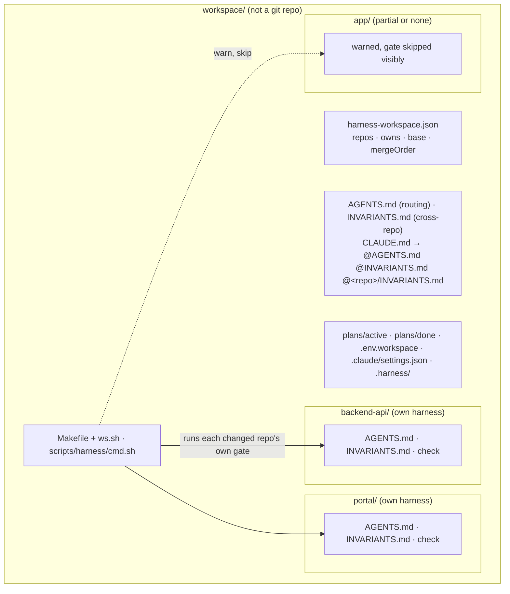

# 4. Multi-repo workspaces

Use this when one feature spans several repos, for example a backend API, a web portal and a mobile app. A **workspace** is a plain folder that is **not** a git repo and holds those repos side by side. Each repo keeps its own harness. The workspace adds only what spans repos: which repo owns which change, contract-first rules, one gate that runs every changed repo's own gate, and cross-repo plans.

## Layout

## Harness state per member

| State | Meaning | Effect |
|---|---|---|
| **present** | `AGENTS.md` + `INVARIANTS.md` + a resolvable `check` command | gated by its own `check` / `check-fast` |
| **partial** | some of those | **warning**, gate skipped visibly |
| **none** | none of those | **warning**, gate skipped visibly |

A partial or missing harness is never a failure, and the workspace never writes into the repo to fix it.

## Setting it up: `/agent-harness:harness-workspace`

Run it in the workspace folder.

1. **Find the repos.** It finds immediate subfolders that are git repos (a worktree's `.git` file counts) and records each one's remote, default branch, harness state and what it owns (from its `AGENTS.md`). A repo that isn't checked out, or has no remote, produces a warning.
2. **Confirm** one table with you: repo · path · harness · owns · merge order. It asks what isn't clear, especially which repo owns the shared contract.
3. **Write workspace files** after one yes: `harness-workspace.json`, `AGENTS.md`, `INVARIANTS.md`, `scripts/harness/cmd.sh`, `Makefile`, `ws.sh`, `CLAUDE.md` (via `make claude-md`), `plans/`, `.claude/settings.json` (shown for you to add if Claude Code refuses the write).
4. **Local wiring.** It reads the backend's port from `<backend>/.env.local` (written by that repo's `make setup`; if missing, it says to run `make setup` first and leaves a `TODO`) and writes `.env.workspace`, e.g. `API_BASE_URL=http://localhost:<port>`. For each frontend or app, it names the member env var that consumes the value (with `file:line`, or `[verify]`) and tells you to copy it there. It never writes a member's `.env` or `.env.local`.
5. **Cross-repo sensors (optional).** Read-only checks such as "backend OpenAPI spec matches the frontend client types", wired into workspace `check`.
6. **Validate** with `make harness-lint` and `make status`.

**Never writes inside a member repo.** To give a member its own harness, run `/agent-harness:harness-init <member>` from the workspace folder (`<member> one-shot` skips the interview); it works inside that member only. Asked "create harness for portal", the agent answers with that command, since it cannot start `harness-init` itself.

**After a plugin update** run `/agent-harness:harness-upgrade` in the workspace folder: it refreshes `ws.sh` and `scripts/harness/`, migrates the workspace files (plan template, cross-repo plans, `AGENTS.md`) and prints `/agent-harness:harness-upgrade <member>` for each member whose harness is behind; it never writes into a member itself. Verification evidence for cross-repo plans is local: `.harness/evidence/<plan file name>`, one block per repo.

## Workspace commands

| Command | Does |
|---|---|
| `make status` | Per repo: branch, uncommitted files, commits ahead of base, harness state |
| `make changed` | Repos with uncommitted changes or commits ahead of base |
| `make check` | `check` in every changed, present repo (the done gate). Prints `ok`, `warn` or `FAIL` per repo. |
| `make check-fast` | Same, with `check-fast` |
| `make test R=<repo> [T=<path>]` | One repo's tests |
| `make branch B=<name> R="<repo> <repo>"` | Create or switch the same branch in the named repos only |
| `make setup` | Each present repo's `setup`, in `mergeOrder` |
| `make bootstrap` | Clone any manifest repo that is missing |
| `make claude-md` | Rewrite `CLAUDE.md` with member `@<repo>/INVARIANTS.md` imports |
| `make harness-lint` | Workspace map consistent; every member in `AGENTS.md`; `mergeOrder` names known repos |

Base per member: `origin/<base>` from the manifest; if none, `origin/HEAD`, else `origin/main`, else `origin/master`. A present member with no `check-fast` (or `setup`) target prints `warn <name>: no 'check-fast' command — skipped`.

**Token budget.** If the workspace `AGENTS.md`, `INVARIANTS.md` and the present members' `INVARIANTS.md` together exceed 5,000 tokens (characters / 4), `make claude-md` drops the member imports, appends missing links under `## Member invariants` in the workspace `AGENTS.md`, and warns `member invariants exceed budget — linked from AGENTS.md (## Member invariants) instead`.

## Cross-repo rules (workspace `INVARIANTS.md`)

- Change the contract first: the repo that owns an API changes and tests it before any client — Critical, enforced by `cross-repo-reviewer`.
- Merge in `mergeOrder`, providers before clients — Critical, enforced by review.
- No breaking API change without a version: additive only until every client has shipped — Critical, enforced by `cross-repo-reviewer`.
- Never write one repo's code in another or import across repos by path — Important.
- One branch name and one issue key across the repos a feature touches — Nice-to-have, visible in `make status`.

Inside a repo, that repo's `AGENTS.md` and `INVARIANTS.md` also apply. If they conflict with the workspace rules, the stricter rule wins; if that is unclear, the agent stops and asks.

## How it behaves at run time

- **Session start** (agent opened in the workspace folder): `[agent-harness] workspace: <name> — each change goes to the repo that owns it …`, then one line per member (`<name>: <branch> · <n> uncommitted · harness <state>` or `not checked out`), the active cross-repo plan, and a reminder of the workspace gate.
- **Stop gate:** runs `check-fast` in each changed, present member with that member's own wiring. A failure blocks the stop and names the repo. Changed members without a complete harness, or whose gate is not wired yet (`gate_wired` not true, or `check-fast` unresolvable), are listed under `Not gated (no complete harness or gate not wired), changed anyway:` when the stop is blocked. The session view marks such a member `harness present (gate not wired)`.
- **`harness-verify` (workspace mode):** `make changed`, then gate and reviewers per changed repo with that repo's diff and rules. When more than one repo changed, it adds `cross-repo-reviewer` (ownership, contract consistency, backward compatibility, merge order). Done only when every repo passes and the verdict is `ALIGNED`.
- **Guards apply everywhere:** force-push, hook bypass and pushes to a repo's default branch are caught even via `cd <repo> && git …` or `git -C <repo> …`.
- **`level.py`** in a workspace also measures each member. For Enterprise, every member must be at Functional or higher.

## Notes

- The workspace folder can stay unversioned. To share it, keep the workspace files in a small git repo whose `.gitignore` lists every member path, and clone members with `make bootstrap`.
- A member repo's `.claude/settings.json` does not apply when Claude Code starts in the workspace folder; the workspace's own `.claude/settings.json` does. Keep both pinned to the harness plugin.
- Workspace files (`AGENTS.md`, `Makefile`, `plans/`, `.harness/`) are never copied or committed into a member repo.
