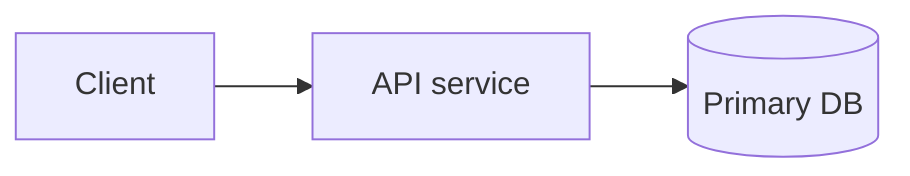

# Architecture

<Two sentences: what the system does and its main runtime pieces.>

## Components
<!-- One entry per deployable or major module: role · entry point (file:line) · talks to · gotcha. -->

## Data flow
<!-- The 2–3 most important request paths, step by step, with file:line. -->

## Boundaries
<!-- Which module may import which; what crosses the network; where validation happens. -->

## Config layers
<!-- Each layer (env vars, config files, flags) with precedence. Names only, never values. -->
